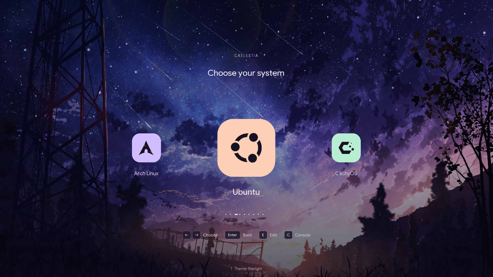
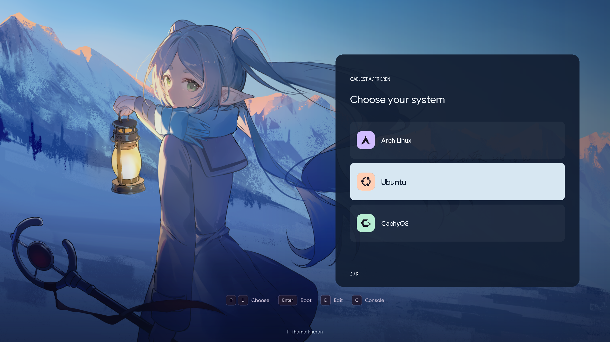

# Caelestia GRUB

A themeable GRUB boot menu inspired by [Caelestia](https://github.com/caelestia-dots/shell). Use the arrow keys to choose an OS and Enter to boot.

| Starlight — centred carousel | Frieren — system cards |
| --- | --- |
|  |  |

## Themes and preview

Both themes are installed together. Press **T** in the boot menu to switch between them without changing the selected operating system. The choice also follows you into and out of submenus. A theme switch cancels the boot countdown, like other navigation keys.

- **Starlight**: a blue-violet starfield with a centred carousel.
- **Frieren**: snowy artwork on the left and system cards on the right. Portrait displays move the cards below the character.

To try the actual GRUB interface without installing it, install QEMU, OVMF and a VNC viewer, then run from this directory:

```sh
make run THEME=starlight
# Or start directly in the other theme:
# make run THEME=frieren
```

In another terminal, open the preview:

```sh
gvncviewer 127.0.0.1:1
```

Use the arrow keys to navigate and **T** to compare themes. The preview uses disposable demo boot entries. Stop QEMU with Ctrl+C in its terminal when finished.

To choose the persistent default for your installed bootloader:

```sh
./install.sh install --theme starlight
# For an existing installation:
./install.sh update --theme frieren
```

The default is saved for future updates. Pressing **T** changes the theme for the current boot session without writing to the boot filesystem.

## Install

You'll need x86_64 UEFI, a working GRUB installation and a mounted FAT EFI partition.

LUKS1 and LUKS2 are supported, including PBKDF2, Argon2i, Argon2id and LVM. Encrypted `/boot` is unlocked before the menu. If only root is encrypted, your existing initramfs handles unlocking as usual.

**1. Install the dependencies.**

Arch / CachyOS:

```sh
sudo pacman -S --needed base-devel bison flex freetype2 curl efibootmgr grub
```

Debian / Ubuntu:

```sh
sudo apt update
sudo apt install build-essential bison flex pkg-config libfreetype6-dev gettext curl efibootmgr grub-common patch xz-utils
```

RHEL / Fedora:

```sh
sudo dnf install gcc gcc-c++ make bison flex pkgconf-pkg-config freetype-devel gettext curl efibootmgr grub2-tools patch xz
```

For encrypted `/boot`, also install `cryptsetup` and `jq`.

With Secure Boot enabled, also install:

```sh
# Arch / CachyOS
sudo pacman -S --needed sbctl sbsigntools openssl jq

# Debian / Ubuntu
sudo apt install sbsigntool openssl jq

# RHEL / Fedora:
sudo dnf install sbsigntools openssl jq
```

On Debian / Ubuntu, also install `sbctl` using its [upstream instructions](https://github.com/Foxboron/sbctl#installation).

Secure Boot needs an existing sbctl key enrolled in firmware **db**. The installer checks and uses that key; it doesn't create or enrol keys. Your kernels or UKIs also need trusted signatures. A shim MOK alone isn't enough.

**2. Download and extract this project**, then open a terminal in its folder:

```sh
./install.sh install
```

Run it as your normal user. The script builds GRUB and asks for sudo for privileged operations. It detects your boot paths automatically. If detection fails, specify them yourself, for example:

```sh
./install.sh install --esp /boot/efi --config /boot/grub/grub.cfg
```

Use your actual mount point and configuration path. You don't need to copy theme files or run `grub-install` separately.

Encrypted boot volumes are detected automatically. You'll need a working LUKS passphrase; Linux may ask again later. The installer never changes LUKS headers or keyslots, or embeds passwords. Detached headers, integrity or hardware-encrypted boot storage and automatic TPM/FIDO2 unlocking in GRUB aren't supported. Keep using your distro's existing unlock method for encrypted root.

**3. After installation succeeds, reboot** and select **Caelestia** in your firmware boot menu. The installer keeps your original bootloader available, so you can select it to go back.

If the screen looks stretched, rerun the installer with `--resolution 1920x1080`, using a resolution supported by your firmware. Use `--jobs 4` to limit build parallelism. Running `./install.sh` without a subcommand still installs as before.

## Update

For a Git checkout, run these commands from the project directory:

```sh
git pull --ff-only
./install.sh update
```

For an archive download, extract the new version and run `./install.sh update` in its directory.

The installer saves your `grub.cfg` path, default theme, resolution, NVRAM preference and explicit `--unlock` volumes in `EFI/caelestia/install.conf` on the EFI partition. Updates reuse those settings; command-line options override them. If your EFI partition uses a custom mount point, pass it again with `--esp /your/mount/point`.

Older installations have no saved settings. The first update detects the paths as before; repeat any custom `--config`, `--resolution`, `--no-nvram` or `--unlock` options once to save them. Use `--nvram` to override a previously saved `--no-nvram`.

Updates build incrementally, keep matching backups of the previous modules, theme, EFI loader and settings, and restore the previous files if deployment fails. Backup paths are printed after installation. They do not recreate an existing Caelestia firmware entry or overwrite the distro's `grub.cfg`. The existing distro menu is read on each boot, so ordinary distro kernel/menu updates do not require rebuilding Caelestia.

To revert to your distro bootloader, select its original entry in the firmware boot menu.

Press **T** to switch themes, **E** to edit, **C** for the console and **Esc** to return.

[Credits](NOTICE.md) · [GPL-3.0-or-later](LICENSE)
